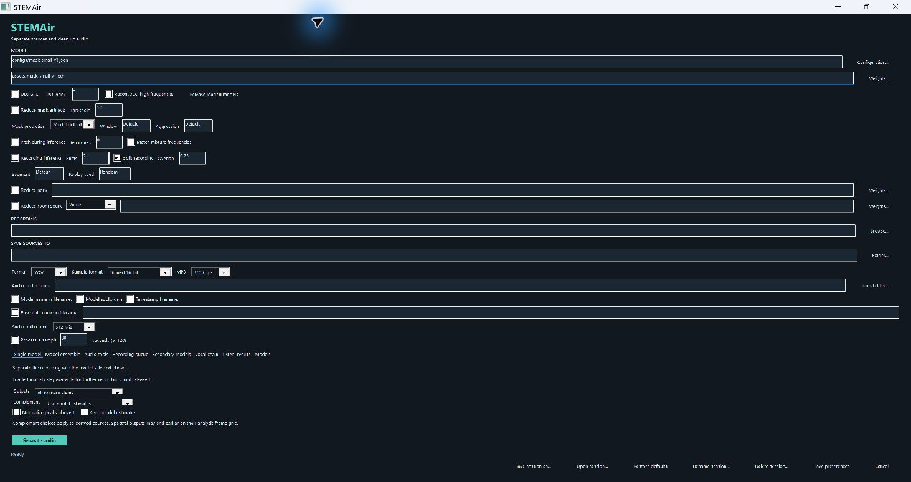

# STEMAir

Separate vocals and music, process recordings, and export individual sources.
STEMAir is a native AIR application for Windows and Linux. Its reusable model
and audio-processing core lives independently in `toolkit/`.



## Features

- Vocal and instrumental separation with CPU and GPU execution.
- Retained models for repeated recordings, queues and model ensembles.
- Noise and room reduction, alignment, pitch and tempo tools.
- Configurable output formats, source selection and file naming.
- Playback of recordings and separated sources.

To listen without vocals, play the instrumental output. To listen without the
music, play the vocal output. In the desktop, use **Listen & results**, choose
the exported file, and select **Play selected**. **Pause** and **Mute** control
that selected file.

## Included model

The compact default model is included at `assets/mask-small-v1.pth`, together
with its configuration, input rules and filter data. A fresh desktop session
selects this model. Its unchanged checkpoint is 31,938,951 bytes:

```text
afb84b3d1da4a7e24033e5a0e85dbde2ac5f5e4b1e839788748735ac3bcc5046
```

Additional profiles require their corresponding weights. Model metadata,
original credits and applicable notices are kept in `licenses/`. The project's
source license does not replace the separate terms of model or runtime assets.

## Compile with AIR

Use a matching extended AIR SDK, native runtime, GPU provider and desktop
adapter. The source requires AIR's retained tensor operations, typed audio
readers and exports, checkpoint readers, transforms and native process support.
An older or unconfigured compiler is not sufficient.

Keep the AIR checkout beside this repository so the shared desktop import
resolves:

```text
workspace/
  AIR/toolkits/desktop/ui.ai
  STEMAir/
```

Configure `AIR_STDLIB`, `AIR_RT_LIB` and `AIR_RT_INCLUDE` for the same SDK.
The SDK's provider link/include configuration and library search paths must
match its native GPU runtime. CPU builds require the matching lazy cleanup
bridge so the CPU entry does not acquire a GPU dependency.

From the repository root, create `build/` and run:

```sh
airc check src/main.ai
airc build src/main.ai --mode release -o build/stem-air
airc build src/gpu_main.ai --mode release -o build/stem-air-gpu
airc build src/desktop.ai --mode release -o build/StemAIR
```

Use `.exe` output names on Windows. `air.project.json` lists the additional
audio, catalog and package-state entry points. `toolkit/air.project.json`
describes the reusable library; it has no application or test targets.

Compilation produces native executables. Deployment also needs the matching
AIR desktop adapter and the selected native runtime libraries. The compact
model uses audio-file and rate-conversion adapters; its CPU path additionally
uses the declared CPU math runtime. Library names and byte identities are in
the runtime metadata under `licenses/`. Install those files into the matching
`runtime/` locations before processing audio. Optional audio processors are
selected separately. This repository contains source and model assets, not
prebuilt runtime libraries.

The desktop entry accepts:

```text
StemAIR AIR_UI PROJECT_ROOT
```

Use an absolute project root and the matching `air-ui` adapter executable.
Select a recording and an existing empty output folder. **Ctrl+Enter** starts
processing, **Escape** requests cancellation, and **Ctrl+Q** closes the window.
Loaded model weights remain available until released or the application closes.

## Source layout

| Path | Purpose |
| --- | --- |
| `src/` | Native application, desktop interface and command-line entries |
| `toolkit/` | Independent separation models and audio processing |
| `configs/` | Model configurations |
| `assets/` | Included checkpoint, filters, input rules and screenshot |
| `licenses/` | Required notices and asset/runtime identities |
| `delivery/package-state.ai` | Native preference-state helper |

Windows and Linux builds have been exercised. Linux validation used a virtual
Linux environment; physical hardware and other distribution versions require
their own compatibility checks. Numerical agreement is model-specific and
does not imply identical values for every backend or equal execution speed.
